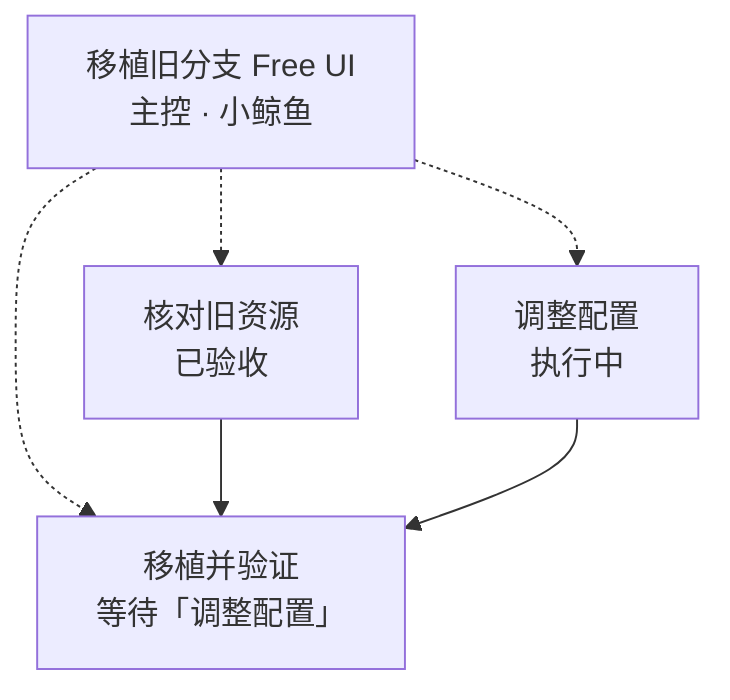

# 机器人担任主控，专题画布跟进交付

状态为进行中。2026-11-28 用户确认本方案并要求开始实施。机器人担任主控，专题和画布从首版开始可见，按第 10 节分步实施并验证。[打开交互原型](bot-topic-leads-prototype.html)

## 1. 人在 Studio 里怎么用

以「把旧分支的 Free UI 移植到当前项目」为例。你在小鲸鱼的对话里说「这件事你来带」。对话在这条请求下展示目标、项目、承接的专题和负责机器人。当前已有明确目标专题和任命授权时，Studio 直接办理。只在项目或接收方有歧义时让你选一次。也可以在请求菜单点「让小鲸鱼带队」。对于只想让一个会话处理的小事，仍可直接启动执行任务。

1. **接单即可看见。** 新专题命名为「Free UI 移植」，主控卡标题用交付目标「移植旧分支 Free UI」。Bot 对话出现「打开专题画布」。哪怕模型尚未跑第一轮，点进去也能看到主控、目标和「等待主控启动」。
2. **派工会出现在图上。** 小鲸鱼先检查已有任务，再安排「核对旧资源」「调整配置」「移植并验证」。前两个可以并行，第三个要等两项前置验收。画布同步出现卡和连线，点击等待状态能定位到具体前置。
3. **追加需求找到原负责人。** 在该专题对话里说「窄屏也要验」，主控将新要求交给实际受影响的任务。跨专题的主聊天里，消息旁显示当前收件专题和主控，可以切换。只读问「做到哪了」读取当前进度，已提交的交付仍可验收。
4. **有问题时知道轮到谁。** 执行任务的技术问题由直属主控处理。需要人确定的业务问题逐层交给总主控。你可以从 Bot 对话、Focus 或画布进入同一条待办。原生工具权限申请显示实际发起会话，按原权限流程处理。
5. **交付可以追到证据。** 子任务提交摘要、改动和验证证据。主控验收或退回直属交付。最终你看到一份根交付，可以展开各项证据，点「通过」或写原因「退回」。退回沿原树修改，下一版有新交付编号。

## 2. 谁对哪件事负责

| 对象 | 持久身份与职责 |
|---|---|
| 机器人 | 可长期使用的名字、头像、职责、技能和模型配置。可以在多个专题任职。普通聊天、群聊和值守各有原来的权限。 |
| 专题 | 一件或一组相关工作的画布、项目分组和专题文档。可以跨项目，也可以容纳多棵有独立交付目标的管理树。 |
| 主控任务 | 稳定的任务 ID 承载目标、上级、下辖、需求版本、提问和交付。每个生效任期绑定一个 Bot。没有直属主控的是总主控，有上级的是中控。 |
| 主控会话 | 任期内处理派工和验收的专属只读会话。一个任期同一时刻至多一个能够执行管理命令的主会话。Bot 主聊天用于接单、选择专题和呈现进度。 |
| 执行任务 | 在指定项目、会话和工作目录里交付结果。每个受管任务至多有一个直属主控。独立执行任务可由人直接跟进。 |

**身份随机器人，工作随任务。** 更名、重置 Bot 主聊天、模型上下文用尽、主控换任，均可通过同一个任务 ID 找回这件事。旧交付显示当时负责的机器人和会话。画布上的参考卡、专题成员关系、前置依赖只用于各自用途，管理权按显式上级链计算。

总主控可把一部分工作交给中控。界面显示「主控 · 小鲸鱼 → UI 中控 · 界面助手 → 执行任务」。建议同一条祖先链上的中控选择另一位机器人，避免同一位机器人以两种身份提交、验收同一份交付。只有一个机器人时可直接带多个执行任务。两个无上下级关系的专题可以同时任命小鲸鱼。

## 3. 入口、选专题与目标路由

| 从哪里开始 | 默认行为 | 需要明确选择的情况 |
|---|---|---|
| Bot 对话或已完成的 Bot 请求 | 当前专题中的「交给主控安排」将原话和相关结论送给指定主控，返回原任务卡；「让此机器人带队」用于新目标 | 新根和已有根的选择显示专题、目标、主控三个名称。显式要追加时进入已有根，显式要独立交付时创建新根 |
| 空专题或专题画布 | 选机器人并填写目标，任命后聚焦主控卡 | 专题已有根时优先展示「交给已有主控」，另外提供「建立独立主控任务」；多个根无默认 |
| 普通任务聊到需要分工 | 「请机器人带队」沿用原任务、所属专题和原上级，带入原话、当前结论、未决问题及证据链接 | 选择已有机器人，或用当前受支持的配置快速创建并命名。已有工作树和未提交文件要在交接中列出，后续执行任务显式接手 |
| 主控拆出中控 | 分工项选「中控」和具体机器人，建卡时同时记录上级与任命 | 展示当前可用的机器人。缺合适人选时，主控可继续直接派执行任务，或向人请求任命 |
| 群聊、Webhook、值守 | 可形成有来源的请求。已由用户配置自动带队的入口按其固定 Bot、项目和目标办理 | 提及机器人、转述消息或外部请求里的自然语言，均不足以新建管理权限；无既定任命范围时展示接单操作 |

**路由用明确的任务 ID。** 专题对话固定收件人。Bot 主聊天的专题卡固定收件人，回复卡片会携带任务 ID。脱离卡片的输入，如果可能指向多项工作，展示选择器并保留草稿。项目或专题同名时附项目和目标。查看进度、答复某个问题、追加工作、重新开工是四种不同操作，消息写入前确定用途。对已完成目标提出新工作时，界面提供「重开这项工作」和「作为新目标」。旧链接在换任后定位同一任务，显示新负责人；归档链接定位历史详情。

同一专题同一请求的重复投递仅追加一次。一个 Bot 可以把请求转给已存在的另一位主控，确认文本会写明实际接手者。首次派工沿用用户所选的项目和范围，增加项目访问或向其他管理树转交已有任务，走现有的人工或专题授权入口。

## 4. 画布是交付界面

管理沿用 Studio 的**虚线**，从主控连到直属下级。依赖用**实线箭头**，从前置指向后项。来源和讨论沿用单独图例。下面是同一专题在配置尚未交付时的状态。

| 位置 | 人看到什么、能做什么 |
|---|---|
| Bot 对话中的专题卡 | 专题、目标、当前主控、需要你处理的事项，入口「打开专题画布」。只订阅关联任务的摘要；进入专题才能展开对应工作记录 |
| 主控卡 | 目标为标题，头像及「总主控／中控 · 名字」、当前阶段和待办。点击可看直属交付、退回原因、专题对话或最终交付 |
| 执行卡 | 工作内容、执行项目、状态。需要等待时写出前置任务名，多个前置显示剩余数量，可逐个定位。已提交和已验收分别显示 |
| 顶部与详情 | 可切换管理线、依赖线，选中主控可聚焦本树；同专题的其他根仍可访问。详情展示需求依据、时间、谁要行动，以及实际会话／结果／变更链接 |
| 导航与恢复 | Bot、看板、Focus 进入时按专题和任务定位、展开被折叠的祖先；只移动视口。普通刷新保留手工布局和拖拽位置。窄窗口用可滚动列表作为画布详情入口 |

画布使用服务端同一份任务、依赖和交付数据。当前任命主控及有效下辖任务必须有本专题的正式任务卡。用户可以移动、分组、折叠、筛选和整理布局。移除活动管理卡的入口提供「收起分支」或跳到转交／归档操作；旧前端整图保存、单卡操作、批量和撤销也要在 Host 检查同一条件。归档按原关系保留历史。补卡优先沿用已有节点、坐标、分组、颜色，新增卡避开已有工作。版本冲突时重新读取最新画布，再应用仍有效的本次改动。

任务状态和主控运行状态分别显示。例如「2 项正在执行，主控会话离线」和「全部下级已验收，等待主控汇总」都可能成立。「待你验收」必须关联当前有效的根交付。工作量按任务 ID 去重统计，明确分母是直属任务还是全部执行任务；完成数量不当作完成百分比。大树按需展开，用现有按树摘要、分页证据和增量更新，避免逐卡轮询。颜色之外保留线型、文字、方向和键盘可达的前置列表。

## 5. 派工、隔离与验收

- **一次分工。** 主控先查已有任务和修改范围，能接续就追加到相应下级。新建任务保存目标、完成标准、项目、执行人配置、工作目录策略、直属上级和依赖。设置前置后，下游显示等待；人要求提前启动时沿用现有例外流程并记录依据。正运行的任务追加依赖时显示变化，已有回合自然收尾。
- **项目与工作树。** Bot 的默认目录只用于选项目提示。主控会话本地只读。普通受管任务走明确选择的项目及执行目录，Plane 写代码的任务使用批准基准上的独立工作树。同一文件的多项改动优先串行或交同一执行任务。依赖验收只提供结果和证据引用；独立工作树之间还要交接实际改动。下游启动前检查所需提交或补丁可在其工作树取得，缺失时显示「等待接入前置改动」。预期要跨树集成时，计划写入负责集成的任务、输入版本和最终验证位置，分支合并由人决定。
- **需求与记忆。** Bot 的职责、模型、技能取本次任命的配置快照。主控收到该目标、授权项目、原请求和显式交接的证据。共同需求由管理根发布，对具体任务显式应用，每个任务声明实际采用的版本。后续修改只通知受影响任务。专题正文和附件只在任务上下文或有权限的链接内传递；长期记忆只保存适合跨专题复用的内容，写入项目专属资料须明确操作。
- **问题与证据。** 有依据的技术取舍由直属主控决定，用户偏好和需求歧义向上转交。工具审批关联真实会话、原生请求和有效期限。Focus、画布和 Bot 的按钮复用同一问题或交付编号。按钮双击、另一入口已处理、任务转交、交付换版均需校验当前对象，过期卡提示刷新。
- **正式验收。** 执行者提交带验证证据的交付。直属主控接受或写理由退回。总主控汇总前核对整个下辖范围已满足现有提交规则，最终提交列出用户要求、各项结果、整体验证和未验证项。只读分析类目标可以用有出处的结论作证据。涉及代码或可见界面的目标附实际改动和对应验证；各子任务测试通过也需说明集成结果。
- **退回、改需求和重开。** 用户退回根交付后，主控定位受影响子任务，复用原卡继续，保留旧交付与人工意见。明确新增工作、前置交付失效、上下级转交时，按现有工作流重新计算有效性并提示受影响节点。读进度、打开证据、换任本身不撤销已验收结果。根交付只能由人确认，主控模型的对照检查只产生意见。

## 6. 任命、换任和中断

| 事件 | Host 的动作 | 用户能看到的结果 |
|---|---|---|
| 建立任命 | 同一事务写入或复用专题、主控任务、正式卡、任期和启动意图，提交后才启动模型 | 立即可看专题和画布，区分「待启动」「工作中」「启动失败」 |
| 旧任务升级 | 保存原任务 ID、上级、专题、摘要和来源。已经启动的会话、后台命令、终端接管及未发送消息安定后切换；未发消息允许送达、取消或留作交接 | 原会话历史可读，交接阶段明确，可以处理卡住的消息。切换前允许取消 |
| 换机器人 | 先验证接任者可用。将旧任期置为交接中，拦截新的管理写入，收存待处理事件；等待已开始的操作到达可记录边界，再原子关闭旧任期、建立新任期 | 原卡、原上下级、原工作树、交付和证据继续可查。接任者收到目标、未决问题、在途工作和最新结果 |
| 接任启动失败 | 保留新任期和失败原因，允许重试同一启动或显式重新任命。尚未完成切换时取消可恢复旧任期，切换后每次改任都产生新记录 | 画布能打开，负责人与实际运行状态分别可见 |
| Bot 停用、模型失效或全局关闭 Bots | 停止新派工和新管理回合。执行中的下级可以安全收尾和提交，交付持久排队。界面保留查看、恢复和换任；显式暂停或停止优先于自动唤醒 | 卡片标「主控暂停」及受影响任务。恢复后重新核对待处理记录并去重投递 |
| 删除 Bot 或归档专题 | 删除有现任任务的 Bot 前列出任职，先换任或归档。专题归档列出活动树和在途工作，按现有停止／归档流程办理。恢复时复检整个作用范围 | 历史沿用任期快照。已归档专题可查看历史，恢复不意外唤醒旧 Goal 或补发旧消息 |

任期和工作阶段独立。审批、执行、等待、交付和验收由任务工作流驱动。任期管理「谁可以在这张卡上发主控指令」。Host 在执行每条管理写入前重查会话、任期、任务、上级和专题。即使旧模型晚回、旧窗口仍开着或在异步操作中换任，也无法新增派工或处理新交付。已提交的合法操作用原回执对账。

## 7. 数据与实现边界

以下是拟新增的最少业务记录，名称供实现讨论。已有任务、画布、依赖、交付、决策和 Plane 原单继续使用各自的 ID。

| 记录 | 字段与约束 |
|---|---|
| 主控任期 | 任期 ID、主控任务 ID、Bot ID、代次、状态、配置及显示名快照、交接摘要、来源、起止时间。数据库约束同一任务最多一个现任，每代唯一；活动任务的专题从任务记录读取 |
| 专属主控会话 | 会话关联任期与代次，一个有管理写权限的活动主会话。恢复／替换原子更新活动会话，历史会话只读。Bot 的常驻聊天任务 ID 与专题主控任务 ID 分开 |
| 请求承接记录 | 稳定来源 ID、动作、请求参数摘要、目标任务、操作 ID、结果回执。相同操作相同参数返回原结果，相同操作不同参数报冲突；新要求可用新操作追加到同一根。原单、Bot 聊天和画布复用同一交付记录 |
| 待办与启动回执 | 复用现有队列，补任务、任期代次、消息／操作 ID 与投递阶段。数据库事务内写意图，提交后启动会话或投递。已送达、已由模型处理、正式提交和人工验收各自有依据 |

**任命命令**接受来源、目标、项目、Bot、明确的「新建／接续／升级」意图、预期的原任期及操作 ID。Host 先校验本地可用项目、有效 Bot 和只读运行时，核对目标未归档、管理链无环、专题与上级一致。来自已有根的追加只登记承接与消息；创建根或中控才建立任期。新建 Bot 和首次任命用同一操作 ID 记录各步，任命失败后可重用已建 Bot。

**事务和恢复。** 首次任命、分工、换任各有独立事务。分工一次写入任务、上下级、卡、依赖和启动意图；任一项失败全批回滚。所有启动入口，包括自动队列、冷恢复、人工重试及 Goal 续跑，重查任期、专题、依赖和暂停状态。启动失败保留同一卡和可重试原因。运行时已启动但回执缺失时按操作关联核对现有会话；外部结果无法判定时标「待核对」，提供继续或人工恢复，避免重复执行。

**权限执行点。** REST、MCP、普通任务新建／编辑、升主控、拆中控、终端、分支会话和旧客户端都经同一任命与管理校验。将当前角色从单看 `task.lead` 收紧到「主控任务 + 当前有效任期 + 指定只读会话」。Bot 常驻聊天既有工具清单继续只负责对应聊天能力，用户点按钮的任命／验收走用户接口。自然语言任命通过客户端提交的真实用户消息 ID 和已确定的目标生成用户操作；模型输出只可提出建议。新会话注入任期、目标、范围和权限上限；技能、历史提示、配置变更均受只读上限约束。专题会话可整理和提案，正式派工、验收及跨树转交仍按各自授权执行。

**状态同步。** 订阅现有任务、专题画布、会话、交付、决策及 Bot 事件，加上任期变化；首次打开或断线重连以 Host 快照校正。用户只触发对一个明确版本的操作。客户端落后时显示「状态更新中」并刷新。保持已处理待办历史，按底层对象去重角标。重命名、同名 Bot 或标题变更不影响路由。

### 几个必须在服务端判定的冲突

| 同时发生的事 | 推荐裁决 |
|---|---|
| 两个窗口对同一条原始请求分别点「独立执行」和「让机器人带队」 | 除了客户端重试用的操作 ID，还对来源请求的首次承接建唯一约束。先成功的一种方式生效，后一个窗口打开现有承接；确实要另做一件事时显式发起新目标 |
| 换任时刚好有人退回／验收结果 | 用户操作锁定任务和结果版本，任期切换只影响主控执行权。事务先后顺序决定实际结果；一旦正式验收，接任会话读取新状态。旧主控已排队的管理操作还要校验任期代次 |
| 主控要等子任务交付，子任务却依赖这个主控的最终交付 | 创建或编辑管理关系、依赖边时，检查「父项完成须等待下级」与显式前置合成的等待关系，包括跨分支、跨根的间接环。返回具体循环路径，由操作者改正关系再保存；普通先后依赖沿用现有启动门禁 |
| 前置代码在另一棵工作树里，任务在等「接入改动」 | 执行人可登记已接入的提交、补丁或人工集成结果，绑定具体前置交付版本；Host 对有 Git 项目的可机械核对部分核对，验收人检查其余证据。具备条件后只恢复这一项，重试同一接入回执不会再次应用补丁 |
| 同一个 Bot 先后在父任务和中控之间换任 | 建立任命、换任、转交子树时同时复检受影响的祖先链与后代，避免在同一条链上造成自审。交付保留实际提交的机器人；若现任验收者正是该版提交者，显示「需要另一位主控验收」，提供换任入口 |
| 正在切换的任务还有原生审批或终端接管 | 在原会话展示「处理原审批」「收回终端」或「取消此次切换」。交接摘要不得把旧批准带入新会话。模型收到用户回答、任务交付和模型运行结束也是三条独立记录 |

只读主控需要的材料可能包含来自项目、工单、聊天或子任务的自由文本。按数据引用并标明来源。管理命令从绑定的当前会话发起，用户级任命、提前开工、批准和最终验收从受信用户动作发起。审计记录保存实际操作者、目标、版本、时间及结果。权限检查或事件投递失败时显示可恢复的原始操作，不把聊天中的「已完成」渲染成成功回执。

## 8. 既有数据、开关和 Plane

**旧主控迁移。** 升级时先盘点活动／已归档主控、待升主控记录、未启动分工、旧交付、孤立或跨范围的管理链。历史完成项继续显示「历史主控」和实际记录，不自动虚构 Bot 身份。活动的匿名主控显示「待绑定机器人」和原树，允许人给一棵树批量映射总主控和各中控，逐项展示并验证。有效任命前不启动新的匿名主控回合，后台只收存结果。已提交且有效的根交付仍可人工验收；需要续办时先任命。旧专题有多根时保留所有根；缺卡按正式归属修复。缺专题的旧根按已有初始化流程建立专题，受管子树随合法根处理，异常链单列说明及人工修复入口。

**切换版本。** 迁移先加表和可选关联，备份并用旧数据库副本演练。记录运行中的会话、暂停的 Goal、原生审批和待启动任务。等人选择合适时机重启 Host。切换到强制规则后，旧客户端单独提交 `lead:true` 时收到可操作的兼容错误，新客户端带上 Bot 及专题意图。已排队的老升主控或中控提案进入「待选机器人」，保留原文和上级。旧客户端仍可执行它支持的普通任务操作。在新数据写入之前可回退应用及配套备份；写入后优先用兼容修复版本，整库回退先导出新增工作并由人明确决定。全局隐藏 Bots 时，任务和专题页仍需提供已存在管理树的只读入口及恢复指引。

**Plane 使用两种明确的交付关联。** 老单保留独立执行任务及原工作树、人工验收、评论回写。新单可在计划确认时选「机器人带队」。建议每张带队工单用一个专属根任务，可以放进已有专题；根任务持计划版本、批准基准和原单关联。这样同专题的两张单可以分别退回、验收和回写。普通本地请求仍可追加给任意已选目标。已有其他来源的根可作为参考或前置。首版切换只针对新接单，正在执行的独立工单按其已批准方式完成。

开工前校验用户看过的计划版本和基准，并只从已批准范围启动执行。重大变更涉及交付范围、目标仓库或基准时，展示差异并再次走原批准流程。根主控的汇总关联各执行任务、证据、基准和实际工作树；查看改动可选具体任务或已集成的最终差异。人工通过最新版根交付后才回写该原单。子交付、中控验收、一般状态追问以及 Bot 检查意见只更新 Studio。回写绑定接单账号、原单及结果 ID。回执丢失先在原单核对，身份变化或目标失效时显示「已验收，回写待处理」。新版本退回重做保留历史，已发出的外部评论作为历史可追溯。

## 9. 现有代码对应点

| 位置 | 当前事实及实施改动 |
|---|---|
| [Bot 请求和执行任务](../packages/host/src/features/bots/service.ts) · [请求记录](../packages/ui/src/bots/BotRequests.tsx) | 普通请求完成后可关联一个独立工作树执行任务。新增承接动作和专题入口，来源按钮共享操作回执，防止同一意图同时走两个启动路径 |
| [角色判定](../packages/host/src/core/role.ts) · [工具清单](../packages/host/src/mcp/tools.ts) | 任务角色依赖 lead 标记，Bot 常驻任务另有工具过滤。任命校验需同时覆盖工具发现、实际调用和直接服务入口 |
| [升主控交接](../packages/host/src/features/tasks/lead-promotion.ts) · [任务服务](../packages/host/src/features/tasks/service.ts) | 已有等待安定、归档旧会话、只读启动及冷恢复。补任期、目标 Bot 配置、操作去重和旧写入拦截 |
| [主控拆分](../packages/host/src/features/taskplans/service.ts) · [画布服务](../packages/host/src/features/canvas/service.ts) | 已有分工事务、卡片放置、管理祖先修复、依赖启动及画布版本校验。增加中控任命、活动卡完整性和执行目录依据 |
| [专题画布](../packages/ui/src/canvas/CanvasPage.tsx) · [任务工作流](../packages/ui/src/task/TaskWorkflow.tsx) | 现有管理／依赖图例、层级高亮和交付入口。增加任期展示、跨入口定位和待处理状态 |
| [逐层验收](../packages/host/src/features/orchestration/service.ts) · [共同需求](../packages/host/src/features/sharedcontext/service.ts) | 复用直属权限、根人工验收、问题路由、结果版本校验和需求绑定，新入口传同一对象 ID |
| [Plane 接单](../packages/host/src/features/teamtasks/plane-bot-jobs.ts) · [Worker 身份判断](../packages/host/src/store/plane-bot.ts) | 现有关联用 task_id 推导独立 worker 身份，任务服务还禁止该 worker 设置上级或升主控。新增工单模式，区分根交付与各执行工作树，按模式校验、展示和回写 |

与已定的[专题默认主控](topic-task-default-lead.md)、[主控初始化](done/lead-topic-initialization.md)、[依赖](done/task-dependencies.md)、[共同需求](done/shared-task-context.md)、[Bot 接单](done/bot-work-loop.md)共用工作流。

## 10. 交付顺序和验收清单

**第一步交付一条能用的本地流程。** Bot 对话／专题／普通任务任命、管理树、从原对话定位到画布、下级派工和逐层验收一起交付。包括重复点击和启动失败恢复。先在隔离数据库验证，开放试用时标明适用的本地入口。

**第二步统一所有主控入口。** 补中控、换任、停用、旧任务绑定、专题提案、新建页、快速开始、画布菜单和旧客户端兼容。盘点所有写 lead 的入口并完成迁移演练后，才启用「只有机器人可担任活动主控」。发布说明写清既有用户如何找回原主控树。

**第三步接入 Plane。** 新单使用专属根、批准范围、逐项工作树证据及按根回写；旧单独立流程与新模式并行验证。各步共享同一专题画布和管理权模型。

| 验收场景 | 必须观察到的结果 |
|---|---|
| 首次带队，启动模型前断线 | 一个任期、一张主控卡；从 Bot 原对话可定位。重开应用后可继续同一次启动 |
| 已有专题、多根、同名、多项目、两个浏览窗口同时接单 | 明确目标才承接；同一操作只产生一份工作；手工布局和其他根完整 |
| 从执行任务升主控，存在后台命令或未交付改动 | 等待安全交接，展示原因；原目录及证据可定位；保留原直属上级和历史会话 |
| 同一 Bot 跨专题、主聊天重置、旧会话或分支迟到 | 两专题的消息、问题、派工和验收互不串线；过期管理写入被拦，接续有记录 |
| 执行中换任、下级同时提交、两位用户同时改任 | 一次换任生效，失败者读回当前负责人；在途交付仅处理一次，详情保留任期来源 |
| Bot 停用、删除、全局关闭、模型不可用、人工暂停和恢复 | 显示哪棵树受影响，留有恢复入口；积压事件可对账，人工暂停优先 |
| 层级管理、跨根依赖、前置退回再交、共享需求换版 | 依赖有效才放行；同专题无管理授权的根无法接管或验收旁支；下游明确采用哪版输入 |
| 分开工作树，前置代码尚未接入，或仓库基准漂移 | 卡片能指明缺少的实际输入；最终交付提供可复核的整体验证和来源 |
| 移除管理卡、并发拖动、筛选、窄屏、深浅主题、键盘操作 | 必需卡和两类线都可找到，坐标冲突可恢复；状态及前置可从文字读出；留截图复核 |
| 几十到数百张卡，只展开一个分支 | 按树取摘要、按需读详情；在相同数据上记录首屏、展开、重连耗时与请求数，同现有画布比较 |
| 查询进度、补充工作、用户待决定、原生审批、两处同时验收 | 查询保留交付；追加按真实影响重开；同一待办一次生效，原生申请由对应执行会话处理 |
| 历史匿名主控、无专题、待切换、已归档、已验收、异常链 | 升级前后核对任务／交付数量、ID、布局、在途记录，异常项可逐个恢复 |
| 新旧 Plane 单并存、退回、账号切换、回写网络中断 | 每单关联自己的最终交付；只对已人工通过的版本写回，超时可核对重试，历史回执可追溯 |

验证分四层记录。Host 用例验证事务、权限、故障注入和恢复。隔离 Electron 用例验证真实界面、定位及同一待办的两个入口。真实模型在临时项目验证任命、派工、退回、重交及人工验收。Plane 另用约定的真实测试单核对回写和实际工作树证据。当前附件仅演示交互状态；以上均为正式实施后的验收条件。
